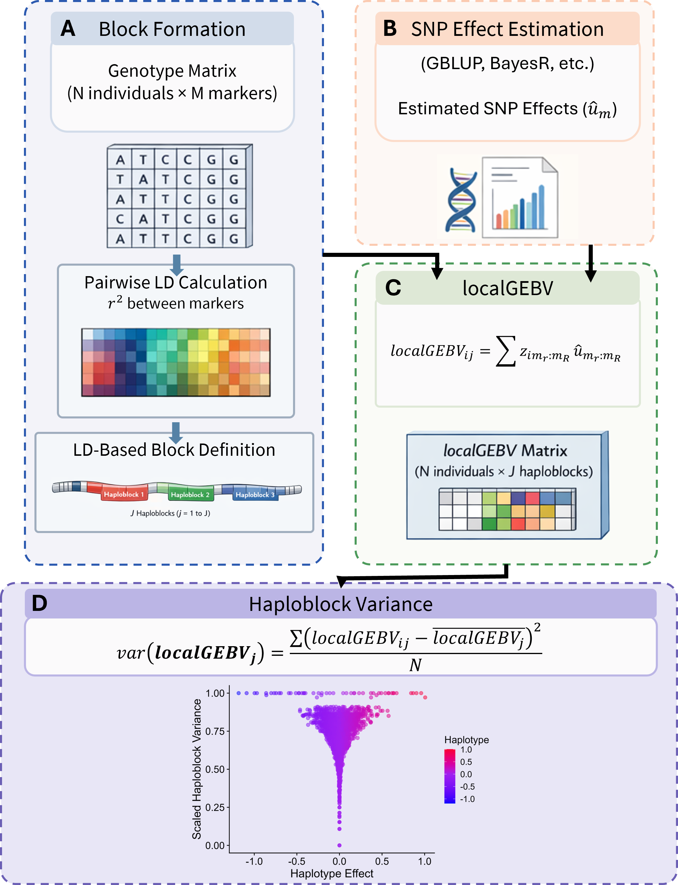

# HapSelect

HapSelect is an R package for haploblock-based genomic selection. It processes inpute genomic and phenotypic files, partitions the genome into blocks (haploblocks), estimates regional genetic value using either a localGEBV framework or a true haplotype-effect framework, identifies high-value genomic regions, optimizes parent selection using a genetic algorithm, and performs simulation to compare alternative selection strategies.

The package is designed for breeding programs running genomic selection, where identifying and targeting the genomic regions with the most exploitable diversity can improve the efficiency of parent choice.

--- 




---


## Documentation
The latest documentation for HapSelect is available on the **[HapSelect documentation site](https://wrshf7.github.io/HapSelect-Docs)**.

## Citation
[Comparison of localGEBV and Optimal Haplotype Stacking Fitness Functions using a Novel R Package: HapSelect](https://doi.org/10.64898/2026.07.08.737160)

<p style="margin-left: 2em; text-indent: -2em;">Shaffer, Will, Victor Papin, Zane Carter, Stephanie M Brunner, Jingyang Tong, Kira Villiers, Hannah Robinson, Kai Voss-Fels, Ben J Hayes, Lee Hickey, and Eric Dinglasan. 2026. Comparison of localGEBV and Optimal Haplotype Stacking fitness functions using a novel R package: HapSelect. BioRxiv. doi:https://doi.org/10.64898/2026.07.08.737160</p>

## Important Papers
<strong>localGEBV Method and Haploblock Formation:</strong><br>
[Shaffer et al. 2025. Local genomic estimates provide a powerful framework for haplotype discovery. Appl Plant Sci.](https://doi.org/10.1016/j.apsx.2026.100002)

<strong>Origin of the localGEBV Method and Parent Optimization with a Genetic Algorithm:</strong><br>
[Kemper et al. 2012. Long-term selection strategies for complex traits using high-density genetic markers. J Dairy Sci.](https://doi.org/10.3168/jds.2011-5289)

<strong>The First Implementation of Haploblocking with localGEBV:</strong><br>
[Voss-Fels et al. 2019. Breeding improves wheat productivity under contrasting agrochemical input levels. Nat Plants.](https://doi.org/10.1038/s41477-019-0445-5)

<strong>The Concept of the Ultimate Genotype:</strong><br>
[Hays et al. 2024. Potential approaches to create ultimate genotypes in crops and livestock. Nat Genet.](https://doi.org/10.1038/s41588-024-01942-0)

<strong>genomicSimulation Package Description and Simulation Comparing the Genetic Algorithm to Truncation Selection:</strong><br>
[Villiers et al. 2024. Evolutionary computing to assemble standing genetic diversity and achieve long-term genetic gain. Plant Genome.](https://doi.org/10.1002/tpg2.20467)


## Workflow at a glance

| Stage | What it does | Key function |
|-------|-------------|--------------|
| Data Import (optional) | Read VCF files, and impute and phase genotypes with BEAGLE | `read_vcf_geno()` / `beagle_phase_geno()` |
| Pairwise LD | Compute r² between all marker pairs | `pairwise_ld()` / `plink_pairwise_ld_geno()` |
| Haploblocking | Partition genome into haploblocks using LD-based, window-based, or graph-based blocking | `def_blocks()` with `ld_strategy()`, `window_strategy()`, or `graph_strategy()` / `block_obj_to_df()`|
| Genomic Prediction | Compute marker effects and prediction accuracy | `create_marker_effects_file()`, `n_fold_cross_validation()`, `cross_validation()` |
| LocalGEBV/Haplotype Effect | Estimate per-block GEBV or haplotype effects per individual | `compute_local_GEBV()` / `compute_haplotype_effects()` |
| Visualisation | Explore haploblock structure, localGEBV/haplotype patterns, and more | `plot_haploblocks()`, `plot_haploblocks_variance()`, `plot_ld_decay()`, … |
| Parent selection | Optimise parent selection using a genetic algorithm | `local_gebv_parent_selection()` / `haplotype_parent_selection()`|
| Basic Simulation | Compare GA and TS parent performance over time and explore how diversity is captured using the [genomicSimulation](https://github.com/vllrs/genomicSimulation) R package. | `localGEBV_vs_TS_simulation()` / `Haplotype_vs_TS_simulation()` |


For full documentation, workflow guides, an in-depth installation guide, and parameter details, see the **[HapSelect documentation site](https://wrshf7.github.io/HapSelect-Docs/latest/)**.

## Installation
1. Download and extract the `.zip` file here: [HapSelect](https://github.com/wrshf7/HapSelect/releases/latest)

2. Ensure [RTools 4.5](https://cran.r-project.org/bin/windows/Rtools/rtools45/rtools.html) (Windows) and [genomicSimulation](https://github.com/vllrs/genomicSimulation) are installed and the OPTIONAL [PLINK 1.9](https://www.cog-genomics.org/plink/) bin and [BEAGLE](https://faculty.washington.edu/browning/beagle/beagle.html) .jar files are in the `bin` folder in your home directory (`~/bin`, or `C:/Users/<username>/bin` on Windows) or a folder on the system `PATH`. Alternatively, point HapSelect at them with `set_plink_path()` and `set_beagle_path()` (see [Configuration](https://wrshf7.github.io/HapSelect-Docs/latest/)).
   - Non-Windows machines must have a C++ compiler compatible with the Rcpp R package.
   - This is usually detected automatically and shipped natively with Linux/Unix and macOS systems.

3. Either set the working directory in R with: `setwd("path/to/unzipped/file/HapSelect/")` (if nested inside the extracted folder) or record the full path to the unzipped directory.

<strong>Install with base R command:</strong><br>

```r
#setting the working directory
setwd("/path/to/unzipped/file/HapSelect/") #if the extracted main folder remains
install.packages("HapSelect", type = "source", repos = NULL)
```

### Warning:

[genomicSimulation](https://github.com/vllrs/genomicSimulation), [RTools 4.5](https://cran.r-project.org/bin/windows/Rtools/rtools45/rtools.html) (for Windows users), [PLINK 1.9](https://www.cog-genomics.org/plink/) (optional), and [BEAGLE](https://faculty.washington.edu/browning/beagle/beagle.html) (optional) dependencies must be installed separately. Alternatively run the helper installation scripts to install all required software. The package is usable without PLINK 1.9 or BEAGLE, but related functions that call PLINK and/or BEAGLE will fail with an error. See [Installation](https://wrshf7.github.io/HapSelect-Docs/latest/) for more details.


## Contributing

For details on contributing to this package, see [the development guide](DEVELOPMENT.md).

## Authors

Will Shaffer, Zane Carter, Victor Papin

The University of Queensland
